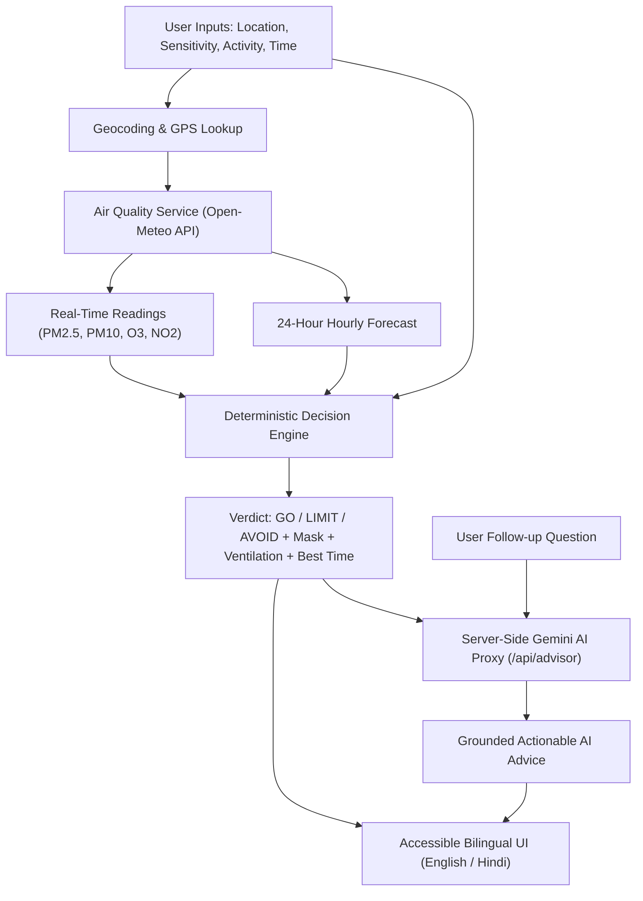

# 🍃 VayuVani — Urban Air Quality & Personal Health Assistant

> **A personal air-quality advisor for city residents.** Answers real-world questions like *"Should I go for a run now?"*, *"Is it safe to open the windows?"*, or *"When's the best time today to take my kid to the park?"*

[](https://github.com/hrishikeshkumar/urban-air-quality-assistant/actions)
[](LICENSE)

---

## 1. Vertical

**Urban Environmental Health & Preventive Well-Being**

Rapid urbanization and seasonal smog episodes leave millions of urban residents breathing hazardous air daily. Conventional weather apps display abstract AQI numbers (e.g., "AQI 168") without clinical context or actionable meaning. 
- An AQI of 130 is moderate for a healthy adult on a brief walk, but potentially dangerous for an asthmatic individual doing vigorous cardiovascular training.
- Opening apartment windows during temperature inversions traps toxic fine particulate inside homes.

**VayuVani** bridges this gap by translating raw environmental sensor readings into **hyper-personalized, clinical-grade daily verdicts** (`GO`, `LIMIT`, `AVOID`) tailored to the user's specific medical sensitivity, planned activity exertion level, and time of day.

---

## 2. Approach and Logic

VayuVani couples a **deterministic, rule-based medical decision engine** with **grounded Gemini AI language synthesis**.

### The Rule-Based Decision Engine
To guarantee reliability and prevent AI hallucinations on health-critical questions, decisions are made by a pure mathematical rule engine before any LLM is queried:

1. **Medical Sensitivity Multipliers**:
   - `General`: Baseline sensitivity ($1.0\times$).
   - `Asthma / Respiratory`: Elevated sensitivity ($1.7\times$), with heightened reactivity to ground-level Ozone ($O_3$) and fine particulate ($PM_{2.5}$).
   - `Heart / Cardiovascular`: Elevated sensitivity ($1.6\times$) with $PM_{2.5}$ bloodstream translocation safeguards.
   - `Pregnancy`: $1.5\times$ risk multiplier protect fetal vascular development.
   - `Elderly (65+)` & `Child (<14)`: $1.5\times - 1.6\times$ multiplier accounting for reduced lung elasticity or developing alveoli.

2. **Activity Exertion & Exposure Modeling**:
   - *Running / High Cardio*: Inhalation minute-ventilation volume multiplies $4-8\times$, forcing particulate deep into pulmonary bronchioles ($1.6\times$ exposure multiplier).
   - *Outdoor Work*: Prolonged 6–8 hour cumulative exposure ($1.4\times$ multiplier).
   - *Window Ventilation*: Evaluated as an indoor air preservation question. If outdoor air exceeds safe indoor thresholds ($AQI > 60$ or $PM_{2.5} > 20\ \mu g/m^3$), the verdict enforces keeping windows shut and circulating through HEPA filtration.

3. **Verdicts & Prescriptions**:
   - **`GO`**: Safe for outdoor activity and natural cross-ventilation.
   - **`LIMIT`**: Reduce duration, throttle cardio heart-rate, or wear standard respiratory protection.
   - **`AVOID`**: Hazardous conditions; cease strenuous outdoor activity; keep windows sealed and run air purifiers.

4. **Optimal 24-Hour Window Calculation**:
   The engine scans the 24-hour hourly forecast array to isolate diurnal low points (e.g. afternoon convective mixing vs. morning ground inversions) and pinpoints the cleanest 2-hour window today.

### Gemini AI Grounding & Server-Side Proxy
Gemini translates the engine's verdict into empathetic, conversational explanations and answers open-ended follow-up questions:
- **Strict Grounding Boundary**: The system instruction forbids Gemini from contradicting the engine's verdict (e.g. Gemini cannot recommend outdoor jogging if the engine flagged `AVOID`).
- **Resilient Fallback Architecture**: Reuses the production proxy pattern with a model fallback chain (`gemini-2.5-flash` $\to$ `gemini-2.0-flash` $\to$ `gemini-1.5-flash`), per-request execution budgets, and instantaneous deterministic fallbacks if offline.
- **Key Secrecy**: `GEMINI_API_KEY` is strictly sequestered server-side.

---

## 3. How It Works



1. **Location Selection**: Select from major urban centers (Delhi, Mumbai, Bengaluru, New York, London) or search any global city via Open-Meteo Geocoding, or use 1-click GPS geolocation.
2. **Profile & Activity Configuration**: Select medical profile (General, Asthma, Heart, Pregnancy, Elderly, Child) and planned task (Running, Commute, Outdoor Work, Window Ventilation, Child Play).
3. **Instant Evaluation**: The engine computes the risk score, assigns color-blind safe visual indicators, benchmarks pollutants against WHO 24-hour limits, and plots the 12-hour AQI trend.
4. **Interactive AI Advisor**: Ask custom queries in English or Hindi (e.g. *"Can I take my 6-year-old child to the park this evening?"*) to receive clinical explanations grounded in real sensor metrics.

---

## 4. Accessibility (A11y) & Inclusivity

- **Color-Blind Safe Palette**: Uses distinct geometric shapes (● Circle for GO, ▲ Triangle for LIMIT, ■ Octagon for AVOID), high-contrast borders, and clear textual badges rather than relying purely on red/green colors.
- **Dedicated High-Contrast Mode**: 1-click high-contrast toggle for low-vision users.
- **Bilingual Localization (English & Hindi)**: Full English and Hindi (हिंदी) UI text, activity options, verdicts, and AI explanations.
- **Screen-Reader Announcements**: Implements `A11yAnnouncer` with ARIA live regions (`aria-live="polite"` and `aria-live="assertive"`), keyboard navigation, and semantic landmarks.

---

## 5. Assumptions

1. **Air Quality Standards**: Calculations adhere to **US EPA AQI breakpoints** and **WHO 2021 Global Air Quality Guidelines** ($PM_{2.5} \le 15\ \mu g/m^3$, $PM_{10} \le 45\ \mu g/m^3$, $NO_2 \le 25\ \mu g/m^3$, $O_3 \le 100\ \mu g/m^3$).
2. **Data Availability**: Defaults to Open-Meteo's global air quality API (free, zero API key required, reliable worldwide coverage), with adapter interfaces for Google Air Quality API and OpenAQ.
3. **Medical Disclaimer**: The assistant delivers public health risk mitigation guidance based on published epidemiological data. It is not a substitute for clinical emergency care.

---

## 6. Testing & CI

Comprehensive automated testing covering:
- Mathematical EPA AQI sub-index calculations
- Activity & sensitivity multiplier boundaries
- Window ventilation safety logic
- Optimal forecast window calculation
- Gemini proxy input validation, error handling, and deterministic fallback compliance

### Run Tests Locally
```bash
# Run unit tests with Vitest
npm test

# Run build bundle
npm run build
```

---

## 7. Quickstart & Local Setup

```bash
# 1. Clone repository
git clone https://github.com/hrishikeshkumar/urban-air-quality-assistant.git
cd urban-air-quality-assistant

# 2. Install dependencies
npm install

# 3. Configure Environment Variables
cp .env.example .env.local
# Add your GEMINI_API_KEY to .env.local

# 4. Start local development server
npm run dev
```

Visit `http://localhost:3000` to interact with VayuVani.
